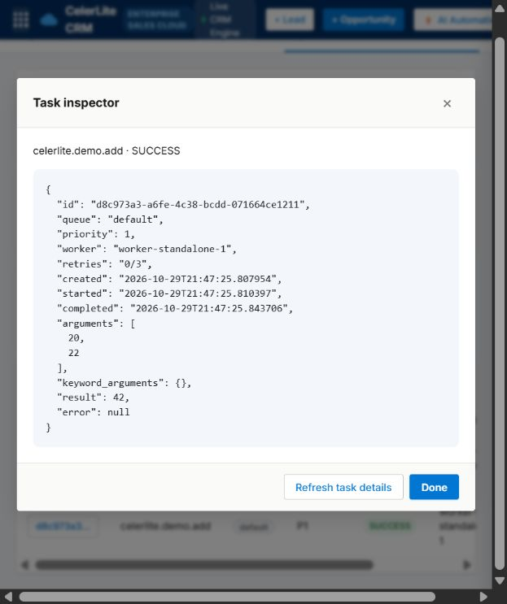

# CelerLite — Customer Workflows & Background Task Operations

[](https://celerlite.onrender.com/)
[](https://python.org)
[](https://fastapi.tiangolo.com)
[](https://redis.io)
[](https://postgresql.org)
[](https://docker.com)
[](LICENSE)

> **Live Deployment**: [https://celerlite.onrender.com/](https://celerlite.onrender.com/)  
> **Swagger API Docs**: [https://celerlite.onrender.com/docs](https://celerlite.onrender.com/docs)  
> **CelerLite** brings customer pipeline work and background task operations into one workspace. It includes lead, account, contact, opportunity, and activity workflows alongside a Redis-backed task engine with priority queues, retries, and dead-letter handling. The public preview uses synthetic CRM records and is read-only; approved workspace members can use sign-in for private records.

---

## Table of Contents

**Reliability update (2026-10-30):** atomic Redis reservations/recovery, all-priority
waiting, atomic retry replacement, and 12 real-Redis regression tests including process-death recovery.
A local 10,000-message broker workload completed with zero missing or duplicate
messages. See [measured results and delivery boundaries](docs/RELIABILITY.md).

- [System Architecture](#system-architecture)
- [Core Engineering Highlights](#core-engineering-highlights)
- [Performance & Benchmarks](#performance--benchmarks)
- [Project Structure](#project-structure)
- [Quick Start](#quick-start)
  - [Live Cloud Deployment](#live-cloud-deployment)
  - [Option A: Full Stack with Docker Compose](#option-a-full-stack-with-docker-compose-recommended)
  - [Option B: Local Standalone Development](#option-b-local-standalone-development)
- [Python SDK Usage](#python-sdk-usage)
- [API & WebSocket Reference](#api--websocket-reference)
- [Testing & Quality Assurance](#testing--quality-assurance)
- [Resume Bullet Points](#resume-bullet-points-for-software-engineers)

---

## System Architecture

CelerLite decouples producers and consumers using Redis for queue scheduling and SQLAlchemy for task and CRM records. PostgreSQL is used when configured; local development can fall back to SQLite.

```
                        ┌────────────────────────────────────────────────┐
                        │             Producer / Client SDK              │
                        │      @task | .delay() | .apply_async()         │
                        └───────────────────────┬────────────────────────┘
                                                │
                                    (1) Enqueue task payload
                                                v
  ┌────────────────────────────────────────────────────────────────────────────────────────┐
  │                                   Redis Broker Layer                                   │
  │  ┌───────────────────────┬────────────────────────┬─────────────────────────────────┐  │
  │  │  Priority Queues      │  Processing & DLQ      │  Pub/Sub Event Bus              │  │
  │  │  • queue:critical     │  • celerlite:proc:*    │  • celerlite:events:tasks       │  │
  │  │  • queue:high         │  • celerlite:dlq:*     │  • celerlite:events:workers     │  │
  │  │  • queue:normal       │  • celerlite:results:* │                                 │  │
  │  │  • queue:low          │  • celerlite:heartbeat │                                 │  │
  │  └───────────────────────┴────────────────────────┴─────────────────────────────────┘  │
  └───────────────────^───────────────────────────┬───────────────────────────────^────────┘
                      │                           │                               │
        (2) Strict Priority Dequeue   (3) Push Heartbeats & Events    (4) Stream Events
                      │                           │                               │
                      v                           v                               v
  ┌─────────────────────────────────┐ ┌───────────────────────────┐ ┌──────────────────────────┐
  │     Distributed Worker Pool     │ │   PostgreSQL Persistence  │ │   FastAPI Gateway Server │
  │ ┌─────────────────────────────┐ │ │ ┌───────────────────────┐ │ │  • REST API (/api/v1)    │
  │ │ Worker Pool Manager         │ │ │ │ Tasks Audit Log       │ │ │  • WebSocket Stream      │
  │ │  • Dynamic Forking & Reap   │ │ │ │ Workers Fleet Table   │ │ │  • Prometheus Exporter   │
  │ │  • Heartbeat Supervisor     │ │ │ │ Dead Letter Queue     │ │ │  • Customer Workflow UI          │
  │ ├─────────────────────────────┤ │ │ └───────────────────────┘ │ └─────────────┬────────────┘
  │ │ Worker Process [1..N]       │ │ └───────────────────────────┘               │
  │ │  • Token-Bucket Limiter     │ │                                             │ WebSockets
  │ │  • Late Ack (TASK_ACK_LATE) │ │                                             v
  │ │  • Timeout Isolation (SIG)  │ │                              ┌───────────────────────────┐
  │ └─────────────────────────────┘ │                              │  CRM + Task Operations Console   │
  └─────────────────────────────────┘                              │  Live KPIs, Donut, Fleet  │
                                                                   └───────────────────────────┘
```

---

## Core Engineering Highlights

### 1. Strict Priority Scheduling (Multi-Queue Ordering)
Tasks are enqueued into separate Redis data structures indexed by priority (`CRITICAL=3`, `HIGH=2`, `NORMAL=1`, `LOW=0`). Redis atomically reserves work in priority order within each application queue. Workers poll configured application queues round-robin so a busy default queue does not monopolize the worker.

### 2. At-Least-Once Delivery with Late Acknowledgment (`TASK_ACK_LATE`)
To make work recoverable after worker failures:
- Tasks are popped from the ready queue into a dedicated unacknowledged processing registry.
- A task is **only acknowledged and cleared from Redis after successful completion**.
- If a worker crashes with a reserved task, recovery can re-enqueue it after the reservation expires. Delivery is at-least-once, so task handlers must make side effects idempotent.

### 3. Exponential Backoff with Full Jitter & Dead Letter Queue (DLQ)
Transient failures are retried using truncated exponential backoff with full jitter to avoid the "thundering herd" problem:
$$\text{delay} = \min(\text{backoff\_max},\ \text{backoff\_base}^{\text{retry}} \pm \text{jitter})$$
- Non-recoverable errors marked with `FatalError` bypass retries immediately.
- Tasks exceeding `max_retries` are routed to the **Dead Letter Queue (DLQ)** along with complete contextual metadata, full exception tracebacks, and original execution parameters.
- Operators can inspect failed tasks and replay entries from the dead-letter queue through the REST API or UI.

### 4. Distributed Sliding-Window Token Bucket Rate Limiting
Task types can be rate-limited cluster-wide (e.g. `rate_limit="60/m"` for external APIs). The limiter uses Redis Sorted Sets (`ZREMRANGEBYSCORE`, `ZCARD`, `ZADD`) to enforce a shared sliding window across workers.

### 5. Task Serialization
Supports both JSON and **MessagePack (`msgpack`)** serialization. JSON and MessagePack are available as serialization formats; comparative performance has not been established by the included broker benchmark.

### 6. Workspace UI & Telemetry
A native HTML/CSS/JS workspace served directly by FastAPI:
- WebSocket updates driven by broker events.
- Live Chart.js throughput graphs & task status donut charts.
- Worker fleet status table with heartbeat health indicators.
- Interactive DLQ explorer with instant replay and task deletion.
- Task submission sandbox for interactive testing.

---

## Performance & Benchmarks

A local Redis broker reserve-and-ack workload and its environment are recorded in
[reliability validation](docs/RELIABILITY.md). It does not measure end-to-end
worker throughput, compare against other frameworks, or establish a latency SLA.

---

## Project Structure

```
CelerLite/
├── celerlite/                  # Core package
│   ├── api/                    # FastAPI application & endpoints
│   │   ├── routes/             # Tasks, Workers, DLQ, Metrics routes
│   │   ├── app.py              # Application factory & lifespan
│   │   └── websocket.py        # Real-time event streaming via Redis Pub/Sub
│   ├── broker/                 # Queue abstraction & Redis driver
│   │   ├── base.py             # Abstract broker interface
│   │   ├── redis_broker.py     # Redis Streams & Lists broker implementation
│   │   └── serializer.py       # JSON & MsgPack serialization layer
│   ├── observability/          # Logging & metrics
│   │   ├── logger.py           # Structured JSON logger
│   │   └── metrics.py          # Prometheus-compatible latency & throughput trackers
│   ├── persistence/            # SQLAlchemy persistence & audit storage
│   │   ├── database.py         # Async SQLAlchemy 2.0 engine & session maker
│   │   ├── models.py           # TaskModel, WorkerModel, DLQEntry
│   │   └── repository.py       # Asynchronous CRUD repositories
│   ├── scheduler/              # Scheduling, throttling & fault-tolerance
│   │   ├── priority.py         # Multi-level priority queue logic
│   │   ├── rate_limiter.py     # Distributed sliding-window token bucket
│   │   └── retry_policy.py     # Exponential backoff + jitter & DLQ routing
│   ├── sdk/                    # Client SDK & task decorators
│   │   └── decorators.py       # @task decorator, AsyncResult handle
│   ├── worker/                 # Worker pool & execution runtime
│   │   ├── heartbeat.py        # Worker liveness publisher & monitor
│   │   ├── pool.py             # Multi-process pool manager & crash supervisor
│   │   └── worker.py           # Worker loop, execution & acknowledgment
│   └── config.py               # Pydantic Settings configuration
├── dashboard/                  # CRM and task operations UI (HTML5, CSS3, JS)
│   ├── index.html              # Dashboard layout & KPI cards
│   ├── styles.css              # Responsive workspace design system
│   └── app.js                  # WebSocket stream & Chart.js dynamic updates
├── docker/                     # Containerization
│   └── Dockerfile              # Multi-stage optimized Python container
├── migrations/                 # Alembic database migrations
│   ├── versions/               # Schema revisions (001_initial_schema.py)
│   ├── env.py                  # Async Alembic execution environment
│   └── script.py.mako          # Migration template
├── scripts/                    # CLI entry points
│   ├── run_api.py              # Start FastAPI server
│   ├── run_worker.py           # Start Worker Pool
│   └── submit_demo_tasks.py    # Demo workload generator
├── tests/                      # Unit, integration, and reliability tests
│   ├── unit/                   # Unit tests (priority, rate limiter, broker, api)
│   ├── chaos/                  # Worker crash & recovery simulation tests
│   └── conftest.py             # Shared fixtures & test database
├── docker-compose.yml          # Full-stack composition (Redis, Postgres, API, Workers)
├── pyproject.toml              # Build & test tooling configuration
└── requirements.txt            # Production & dev dependencies
```

---

## Quick Start

### Live Cloud Deployment
Access the live deployment:
- **Console UI**: [https://celerlite.onrender.com/](https://celerlite.onrender.com/)
- **Swagger REST Docs**: [https://celerlite.onrender.com/docs](https://celerlite.onrender.com/docs)
- **Prometheus Metrics**: [https://celerlite.onrender.com/api/v1/metrics](https://celerlite.onrender.com/api/v1/metrics)

### Access, demo, and persistence

- The sign-in screen has a small **Preview the demo** action. Demo sessions receive a short-lived, read-only cookie and synthetic CRM data stored in a database separate from private workspace records. CRM writes and task, worker, metrics, and dead-letter APIs are unavailable in demo mode.
- Private workspace access is allowlisted through Supabase Auth. Public self-signup is disabled. Configure `CELERLITE_SUPABASE_URL`, `CELERLITE_SUPABASE_PUBLISHABLE_KEY`, `CELERLITE_AUTH_ALLOWED_USER_IDS`, and `CELERLITE_AUTH_PUBLIC_ORIGIN`; Google sign-in also requires the Google provider and callback allowlist in Supabase. See [authentication setup](docs/AUTHENTICATION.md).
- The Render free service has no persistent local disk. Without a separately configured durable `CELERLITE_DATABASE_URL` or `DATABASE_URL`, private CRM and task records can disappear after a restart. Demo data is synthetic and can be recreated from seed data.

---

### Option A: Full Stack with Docker Compose (Recommended)

Starts Redis 7, PostgreSQL 15, the FastAPI Gateway, 2 worker containers (8 processes total), and the Real-time Dashboard:

```bash
docker-compose up --build
```

Access the services:
- **Real-Time Dashboard**: [http://localhost:8000](http://localhost:8000)
- **Interactive Swagger Docs**: [http://localhost:8000/docs](http://localhost:8000/docs)
- **Prometheus Metrics**: [http://localhost:8000/api/v1/metrics](http://localhost:8000/api/v1/metrics)

---

### Option B: Local Standalone Development

#### 1. Prerequisites
- Python 3.11+
- Redis running on `localhost:6379`
- PostgreSQL (optional, falls back to SQLite for local development)

#### 2. Virtual Environment Setup
```bash
# Clone the repository
git clone https://github.com/your-username/celerlite.git
cd celerlite

# Create and activate virtual environment
python -m venv .venv
# On Windows:
.venv\Scripts\activate
# On Linux/macOS:
source .venv/bin/activate

# Install dependencies
pip install -r requirements.txt
```

#### 3. Run the Services
Open separate terminals:

```bash
# Terminal 1: Run the API Server & Dashboard
python scripts/run_api.py

# Terminal 2: Run the Worker Pool (4 processes)
python scripts/run_worker.py

# Terminal 3: Submit Demo Workload
python scripts/submit_demo_tasks.py
```

---

## Python SDK Usage

### 1. Defining Tasks

```python
from celerlite.sdk.decorators import task
from celerlite.scheduler.priority import Priority
from celerlite.scheduler.retry_policy import FatalError

@task(queue="default", max_retries=3, timeout=30)
def process_data(records: list) -> dict:
    return {"processed": len(records), "status": "ok"}

@task(queue="payments", max_retries=5, rate_limit="100/m")
def charge_customer(customer_id: str, amount_cents: int) -> str:
    if amount_cents <= 0:
        raise FatalError("Invalid transaction amount; routing directly to DLQ")
    # Execute payment logic...
    return f"txn_{customer_id}"
```

### 2. Submitting Tasks & Checking Results

```python
# Asynchronous dispatch (fire-and-forget)
async_res = process_data.delay([1, 2, 3, 4, 5])
print(f"Task submitted with ID: {async_res.task_id}")

# Submit with strict priority
vip_task = charge_customer.apply_async(
    args=["cust_9981", 4999],
    priority=Priority.CRITICAL,  # Handled before NORMAL/LOW tasks
    queue="payments"
)

# Blocking retrieval with timeout
result = async_res.get(timeout=10.0)
print(f"Result: {result}")

# Revocation
vip_task.revoke()
```

---

## API & WebSocket Reference

### REST Endpoints

| Method | Endpoint | Description |
|:---|:---|:---|
| `GET` | `/api/v1/crm/stats` | Executive KPI aggregates (Pipeline sum, win rate, deal counts) |
| `GET`, `POST` | `/api/v1/crm/leads` | List inbound leads or create a new lead |
| `PUT`, `DELETE` | `/api/v1/crm/leads/{id}` | Update lead status/score or delete lead |
| `POST` | `/api/v1/crm/leads/{id}/convert` | Convert qualified lead directly into an Opportunity |
| `GET`, `POST` | `/api/v1/crm/deals` | List pipeline opportunities or create new deal |
| `PUT`, `DELETE` | `/api/v1/crm/deals/{id}` | Advance deal stage in Kanban pipeline or delete |
| `GET`, `POST` | `/api/v1/crm/accounts` | Manage corporate accounts directory |
| `GET`, `POST` | `/api/v1/crm/contacts` | Manage contacts linked to accounts |
| `GET`, `POST` | `/api/v1/crm/activities` | Activity timeline (Calls, Meetings, Tasks, Notes) |
| `POST` | `/api/v1/crm/automate` | Queue transparent lead scoring, pipeline forecast, or follow-up creation |
| `POST` | `/api/v1/tasks/submit` | Enqueue a task with priority, args, and timeout |
| `GET` | `/api/v1/tasks/{task_id}` | Retrieve task state, error messages, and timing |
| `GET` | `/api/v1/tasks/{task_id}/result`| Fast-path retrieval of completed result from Redis |
| `POST` | `/api/v1/tasks/{task_id}/revoke`| Mark a task as revoked so workers discard it |
| `GET` | `/api/v1/tasks/stats` | Aggregated counts by status and real-time throughput |
| `GET` | `/api/v1/workers` | List all active/dead workers with heartbeats & PIDs |
| `GET` | `/api/v1/dlq` | List dead-lettered tasks with full tracebacks |
| `POST` | `/api/v1/dlq/{entry_id}/replay` | Re-queue a failed task with reset retry counter |
| `POST` | `/api/v1/dlq/replay-all` | Bulk-replay all dead-lettered tasks |
| `GET` | `/api/v1/metrics` | Prometheus-compatible telemetry snapshot |
| `GET` | `/health` | Broker and database connectivity, configured auth, and demo availability |

### WebSocket Endpoint

```
ws://localhost:8000/api/v1/ws/events
```
Emits real-time JSON frames whenever tasks are submitted, started, completed, failed, retried, or dead-lettered:

```json
{
  "event": "task_completed",
  "task_id": "e6a2b0fd-4f11-48e0-a7d1-9ce4ad2103f5",
  "task_name": "celerlite.demo.add",
  "worker_id": "worker-f481ac90",
  "duration_ms": 1.45,
  "queue": "default"
}
```

---

## Testing & Quality Assurance

The test suite covers unit logic, concurrency boundaries, fault tolerance, and chaos failure scenarios:

```bash
# Run the complete test suite
pytest -v

# Run with test coverage report
pytest --cov=celerlite --cov-report=term-missing
```

### Test Coverage Highlights:
- **Unit Tests**:
  - `test_serializer.py`: MsgPack & JSON serialization round-trips, validation, and payload integrity.
  - `test_priority.py`: Strict priority ordering, key generation, and queue ordering.
  - `test_retry_policy.py`: Exponential backoff calculation, jitter randomization, and FatalError bypassing.
  - `test_rate_limiter.py`: Sliding window sorted-set rate limiting and token bucket throttling.
  - `test_heartbeat.py`: Heartbeat publishing, Redis TTL verification, and stale worker detection.
  - `test_repository.py`: Async SQLAlchemy CRUD, state transitions, and DLQ operations.
  - `test_api.py`: FastAPI endpoints, dependency overrides, and HTTP status codes.
- **Chaos & Fault Tolerance Tests**:
  - `test_worker_crash.py`: Simulates abrupt worker process termination (SIGKILL/OOM) and verifies that the supervisor automatically replaces dead workers.

---

## Resume Bullet Points for Software Engineers

Use only measurements and features you have personally re-verified before making resume claims. The checked-in local broker workload in [docs/RELIABILITY.md](docs/RELIABILITY.md) records 10,000 reserve-and-ack operations at 3,079.1 messages/sec with no missing or duplicate messages; it does not measure end-to-end task execution or customer impact.

Possible technically accurate bullets after reviewing the current implementation:

- Built a Redis-backed Python task engine with atomic reservation, priority handling, retries, worker recovery, and a dead-letter queue; documented its at-least-once delivery boundary.
- Measured a 10,000-message local broker workload at 3,079 messages/sec with zero missing or duplicate messages across the test run; broker reserve-and-ack only, not end-to-end execution.
- Added queue-backed CRM workflows for explainable lead-fit scoring, probability-weighted pipeline snapshots, and idempotent follow-up task creation.
- Implemented allowlisted Supabase sign-in and an isolated, read-only recruiter preview using synthetic CRM data.

These describe engineering scope and a local workload, not proven business impact. Add customer or operational impact only after collecting real usage data.

---

## License

This project is licensed under the MIT License — see the [LICENSE](LICENSE) file for details.

## Task inspection and submission

In **CelerLite Task Queue & Workers**, choose **Run Custom Task**. Enter JSON
arguments and keyword arguments. For example, run `celerlite.demo.add` on the
`default` queue with `[20, 22]` and `{}`. Invalid JSON or argument types remain
in the form with an inline error. Submission opens a task inspector; refresh it
to see the worker, timestamps, arguments, saved result, or execution error.
Task IDs in the history also reopen the inspector. The standalone worker must
consume the selected queue for execution to occur; standalone mode does not
provide the full distributed worker retry lifecycle.


